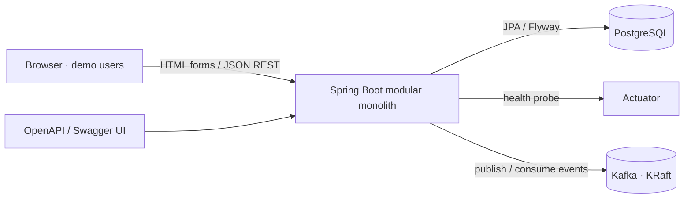
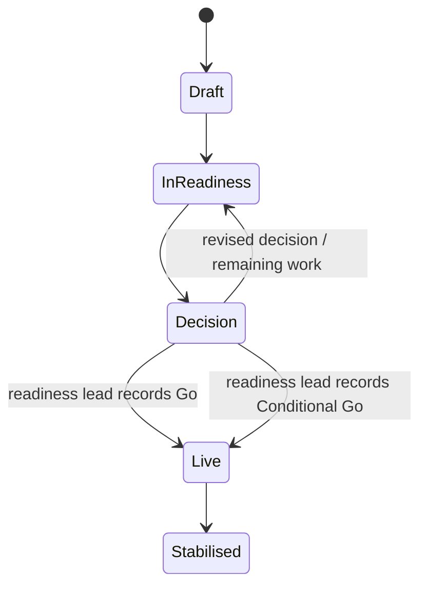
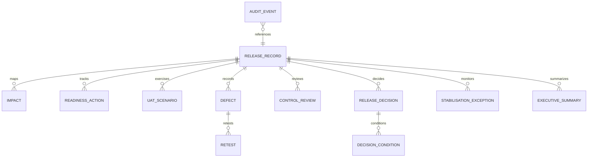
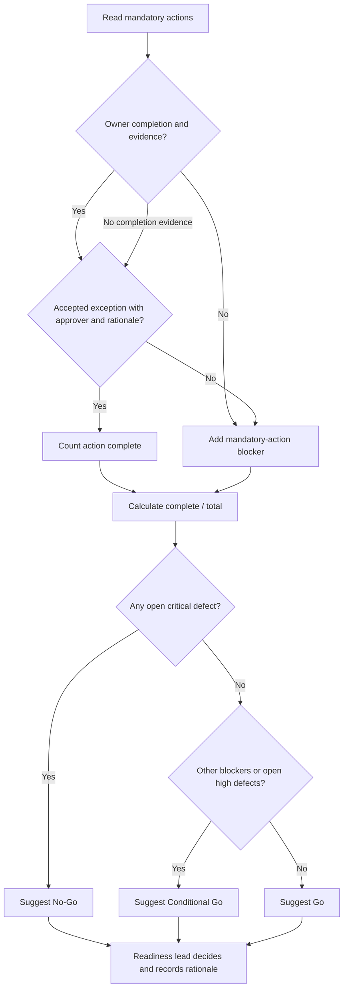

# Architecture

All examples and records are synthetic. The application is a modular monolith for a designed scenario.

## System context

Phase 2 Kafka topics are available, but the scheduled producer is disabled by default (`demo.events.enabled=false`). When enabled, it publishes only while the release lifecycle status is `LIVE`, reached by a readiness lead's recorded Go or Conditional Go decision. The consumer routes failed and rejected events to `stabilisation-exceptions` and stores queue entries for the Stabilisation page. Stored exception rows are capped at 500 by default, with oldest-first eviction. Topics and queue entries contain synthetic examples only.

## Workflow states

These are illustrative workflow states. The prototype seeds the release in readiness. Only a readiness lead's recorded Go or Conditional Go decision moves it to Live; event production also requires the explicit demo property to be enabled.

## Data model

Every stored record includes a `synthetic` marker. `AuditEvent` stores actor, role, entity, entity id, action, before/after summary, and timestamp. Relationships are represented by identifiers to keep the demo schema easy to inspect.

## Readiness gate flow

An attached document without recorded owner completion never passes the mandatory-action gate. The app's output remains a suggestion; no automatic decision is stored.
