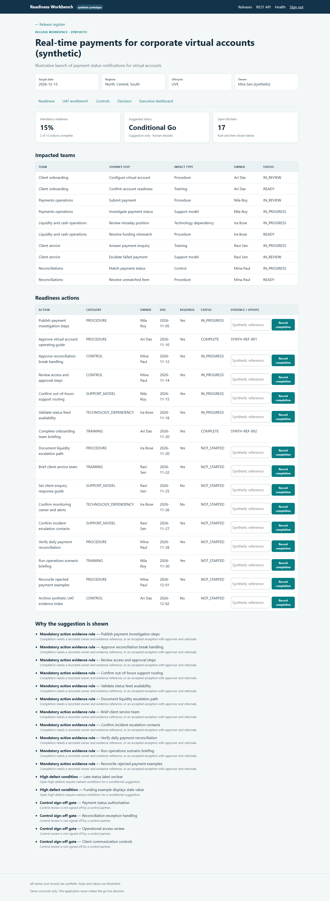
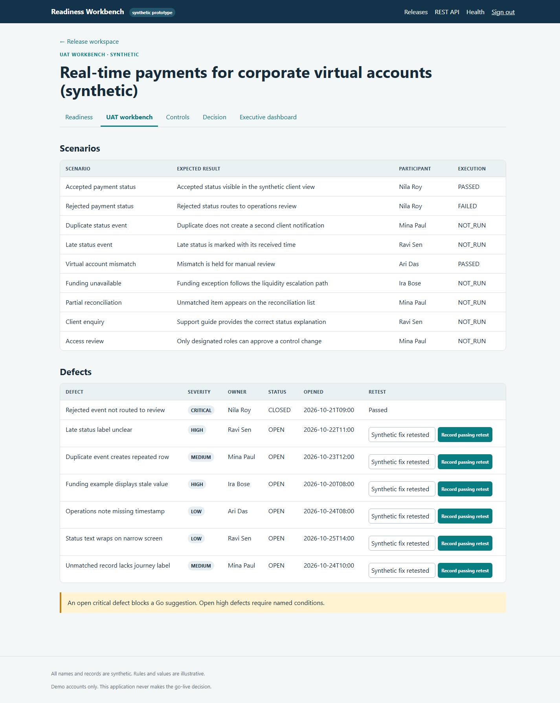
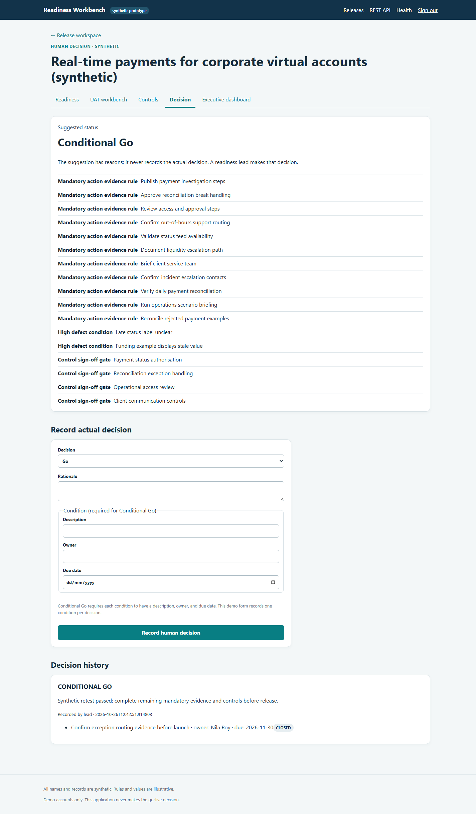
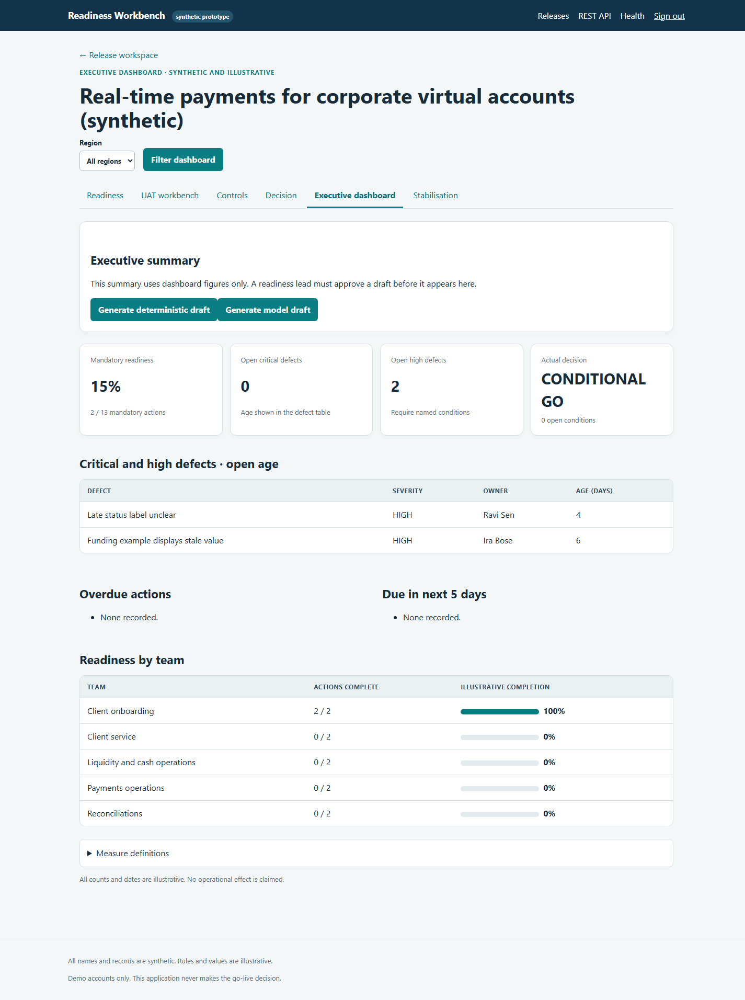

# Synthetic readiness workbench case study

## Phase 2

Kafka runs in single-node KRaft mode. After a readiness lead records Go or Conditional Go, the synthetic producer emits payment-status events about once a second. A consumer routes failed and rejected messages to a stabilisation topic and persists visible queue entries with severity, age, affected journey step, owner, and next action. Events arrive independently of the UI and can spike, so asynchronous delivery buffers them without blocking browser requests. No real payment is initiated.

The dashboard can generate a deterministic summary from dashboard facts. Optional model output uses the same facts, is labelled as a draft, and stays off the dashboard until a readiness lead approves it. Approval is audit logged. Model tests inject a fake client; credentials are read only from `OPENAI_API_KEY` in the environment.

## Phase 2

Kafka runs in single-node KRaft mode. After a readiness lead records Go or Conditional Go, the synthetic producer emits payment-status events about once a second. A consumer routes failed and rejected messages to a stabilisation topic and persists visible queue entries with severity, age, affected journey step, owner, and next action. Events arrive independently of the UI and can spike, so asynchronous delivery buffers them without blocking browser requests. No real payment is initiated.

The dashboard can generate a deterministic summary from dashboard facts. Optional model output uses the same facts, is labelled as a draft, and stays off the dashboard until a readiness lead approves it. Approval is audit logged. Model tests inject a fake client; credentials are read only from `OPENAI_API_KEY` in the environment.

## Context

This personal prototype uses an invented transaction bank and a designed launch scenario: real-time payment status notifications for corporate virtual accounts. All people, teams, records, dates, values, evidence references and examples are synthetic.

## Designed problem

The scenario models readiness information spread across impacted operations teams, action owners, UAT scenarios, defects, control reviews, evidence references and a human launch decision. The prototype puts those records in one release workspace and explains the illustrative gates that affect its suggestion.

## Design

The application uses a Spring Boot modular monolith with server-rendered Thymeleaf pages and a REST API. PostgreSQL stores the records, Flyway seeds a demonstration release, and Spring Security provides in-memory demo roles. The readiness service calculates the mandatory-action numerator and denominator and reports each triggered rule. The decision service accepts an actual decision only from a readiness lead and stores its rationale and conditions. Material writes append an audit event.

## Walkthrough

1. Open the seeded release workspace and check the impacted teams and mandatory actions.
2. Open the UAT workbench. The synthetic critical defect is open, so the suggestion reports No-Go with a critical-defect blocker.
3. As the readiness lead or UAT lead, record a passing retest to close the critical defect.
4. Review the updated suggestion. Open high defects and remaining mandatory actions require a Conditional Go suggestion.
5. As readiness lead, record Conditional Go with a named condition, owner, due date and rationale.
6. Close the condition. It remains in decision history as closed.

The prototype records no decision from a calculation. The readiness lead chooses and records the actual outcome.

## Dashboard

The dashboard shows the mandatory-action fraction, open critical and high defects with age, overdue actions, actions due within five days, illustrative readiness by impacted team, the last recorded decision and open conditions. Its measure definitions are visible on the page. Seeded readiness items are not region-specific; a region filter identifies release scope, not regional action attribution.

## Trade-offs and limitations

- The small monolith avoids distributed deployment and keeps the demo workflow inspectable.
- In-memory users and demo passwords are for local use only; there is no production identity system.
- Seed values and rules are illustrative and require review before any real operational use.
- The prototype has no client integration, payment processing, event streaming, AI-generated summary, real evidence repository or deployment pipeline.
- Team readiness maps action owners to impacted teams with an illustrative count; it is not a risk score.

## Screenshots

Screenshots captured from the local browser after the synthetic end-to-end walkthrough:

### Release workspace

### UAT workbench

### Human decision page

### Executive dashboard

