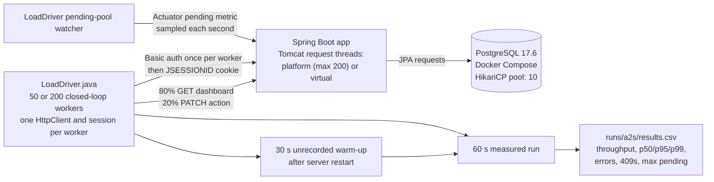

# A2 HTTP load test setup

Each worker keeps its own HTTP client and cookie jar. It sends HTTP Basic credentials to establish a session, then reuses the session cookie for subsequent requests. Workers issue requests in a closed loop, rotating action updates across the release's seeded actions. The load driver uses a fixed random seed for the 80/20 dashboard and action mix.

For the order check, restart the application with `spring.threads.virtual.enabled=false`, perform the unrecorded warm-up, and run the 200-worker workload once. The recorded comparison cells use 50 and 200 workers, platform and virtual request threads, three measured runs per cell, and the same 30-second warm-up plus 60-second measurement window. The Actuator watcher records the maximum observed Hikari pending count during the measurement window.

These are local synthetic-workload measurements on one laptop. They describe this app, dataset, request mix, thread configuration, and connection pool; they do not establish production capacity.
